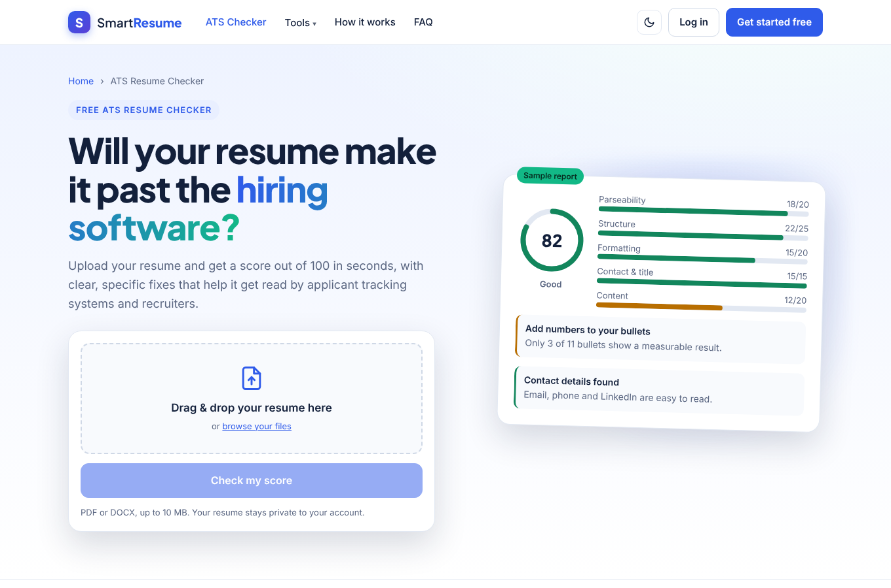
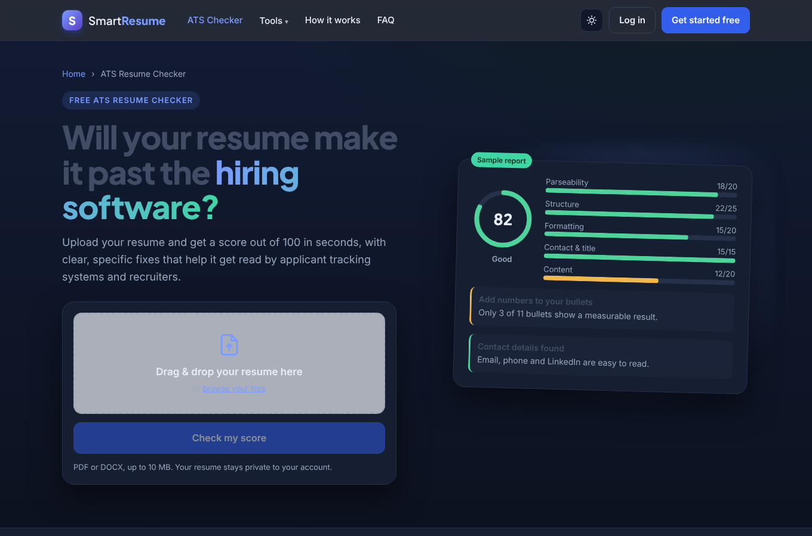
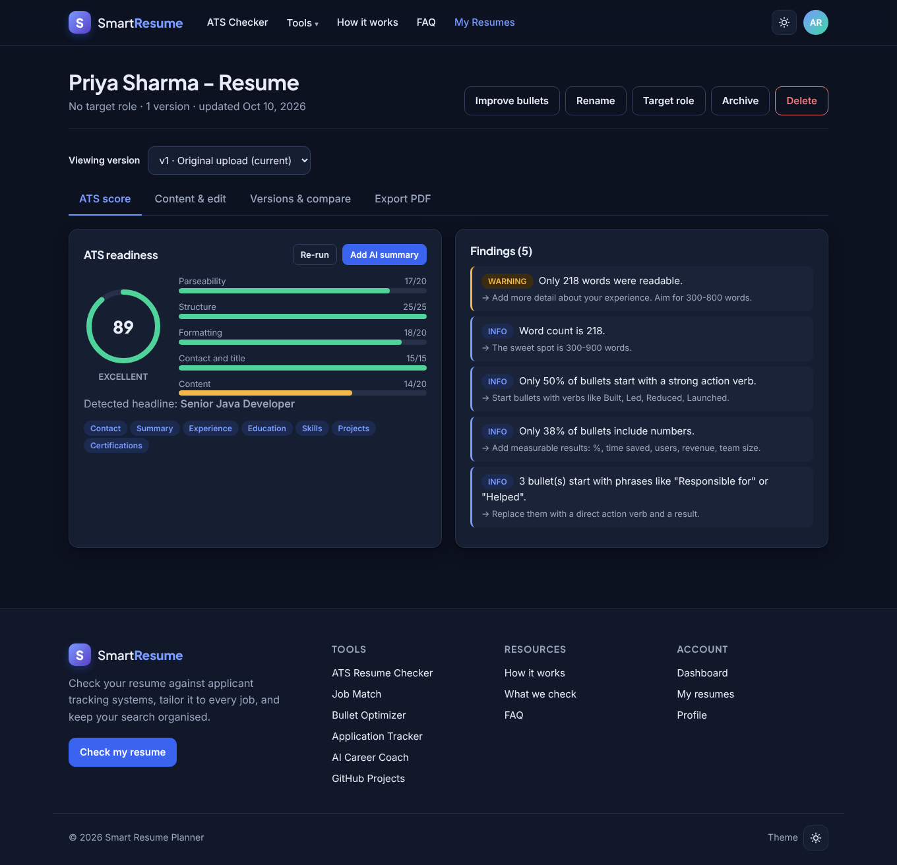
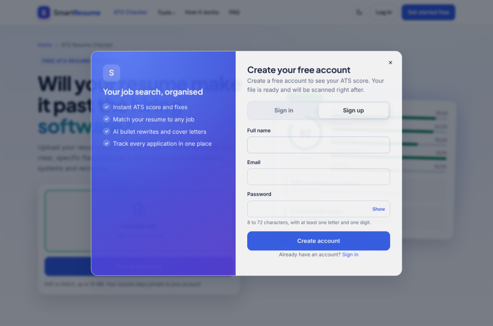
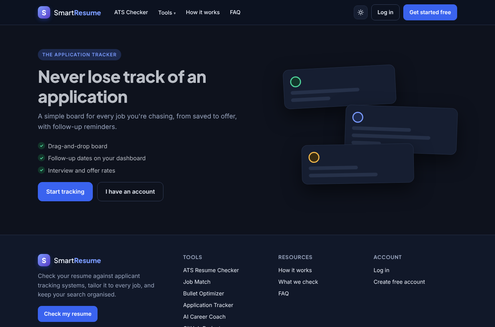
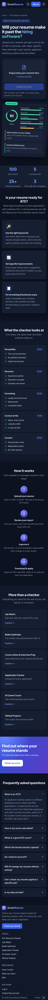

<p align="center">
  
</p>

<h1 align="center">Smart Resume Planner</h1>

<p align="center">
  An AI-assisted resume builder and job-application planner.<br>
  Score your resume against ATS rules, match it to job descriptions, optimize weak bullets, track applications, and export a polished PDF.
</p>

<p align="center">
  
  
  
  
  
  
</p>

<p align="center">
  <a href="https://github.com/Shafeeq0807/smart-resume-planner"><b>github.com/Shafeeq0807/smart-resume-planner</b></a>
  &nbsp;·&nbsp;
  <a href="docs/video/smart-resume-planner-demo-38s.mp4">Watch the 38-second demo</a>
</p>

---

## Features

| | |
|---|---|
| **ATS scoring** | Upload a PDF or DOCX and get a score with concrete issues to fix. An optional AI summary explains the result. |
| **Version control for resumes** | Every edit creates a new immutable version. Compare any two versions, or restore an older one. |
| **Job matching** | Paste a job description and see which required skills you have, which are missing, and the evidence for each. |
| **AI bullet optimizer** | Finds weak bullet points and proposes stronger rewrites that you can accept or reject one by one. |
| **Cover letters and interview prep** | Generates a cover letter and likely interview questions for a specific role. |
| **GitHub project import** | Analyzes public repositories and turns them into resume entries. |
| **Application tracker** | Kanban board with status history, follow-up reminders, and statistics. |
| **AI career coach** | Streaming chat (server-sent events) that knows your resume and target roles. |
| **PDF export** | Renders your resume with several templates (Classic, Modern, Technical). |

## Screenshots

<table>
  <tr>
    <td align="center"><br><sub>Home page with the ATS checker (light mode)</sub></td>
    <td align="center"><br><sub>Home page (dark mode)</sub></td>
  </tr>
  <tr>
    <td align="center"><br><sub>Resume report with ATS score and issues</sub></td>
    <td align="center"><br><sub>Sign-up pop-up, shown only when an action needs an account</sub></td>
  </tr>
  <tr>
    <td align="center"><br><sub>Application tracker page for signed-out visitors</sub></td>
    <td align="center"><br><sub>Mobile layout</sub></td>
  </tr>
</table>

A short screen recording is in [`docs/video/smart-resume-planner-demo-38s.mp4`](docs/video/smart-resume-planner-demo-38s.mp4).

## Architecture

<p align="center">
  
</p>

The React single-page app talks to a Spring Boot REST API over `/api`. The API keeps data in MySQL (schema managed by Flyway), stores uploaded files on disk or S3, and calls an LLM provider through Spring AI. The default provider is AIML API; OpenAI, Groq, and Ollama (local) are available through Spring profiles.

## Tech stack

**Backend** (`smart-resume-planner/`): Java 21 with virtual threads, Spring Boot 3.5, Spring Security with JWT (rotating refresh tokens), Spring Data JPA, Flyway, Spring AI, Apache Tika, OpenPDF, springdoc OpenAPI.

**Frontend** (`smart-resume-frontend/`): React 18, TypeScript, Vite, React Router, light and dark themes.

## Getting started

### Prerequisites

- Java 21 and Maven 3.9+
- Node.js 20+ (`node -v` should print v20 or higher)
- MySQL 8
- An API key for the AI provider (AIML API by default)

### 1. Clone

```bash
git clone https://github.com/Shafeeq0807/smart-resume-planner.git
cd smart-resume-planner
```

### 2. Start the backend

```bash
cd smart-resume-planner
# MySQL 8 must be running with a database named smart_resume_planner
export DB_USER="root"                             # your MySQL user
export DB_PASSWORD="<your MySQL password>"
export JWT_SECRET="<base64 secret, 256+ bits>"   # e.g. openssl rand -base64 48
export AIML_API_KEY="<your AI provider key>"
mvn spring-boot:run
```

Open http://localhost:8080/swagger-ui.html. If it loads, the API is ready. See [`.env.example`](smart-resume-planner/.env.example) for every variable and [smart-resume-planner/README.md](smart-resume-planner/README.md) for the API map.

### 3. Start the frontend

In a second terminal:

```bash
cd smart-resume-frontend
npm install
npm run dev
```

Open http://localhost:5173. The Vite dev server forwards `/api` calls to `http://localhost:8080`, so no CORS setup is needed locally. More detail is in [smart-resume-frontend/README.md](smart-resume-frontend/README.md).

### 4. Try it

1. Drop a PDF or DOCX into the upload box on the home page and click **Check my score**. Create an account in the pop-up and the scan starts straight away.
2. Edit the content and save to create version 2, then compare versions.
3. Export a PDF with one of the templates.
4. Use **Tools** for Job Match, the Bullet Optimizer, the Application Tracker, the AI Career Coach and GitHub Projects.

### Troubleshooting

| What you see | Fix |
|---|---|
| "Request failed (500)" or the page cannot reach the API | The backend is not running on port 8080. Start it, or change the proxy target in `vite.config.ts`. |
| "The AI service is not available" | `AIML_API_KEY` is missing or wrong, or the model is not on your plan. |
| `npm install` fails | Check Node.js is 20+, delete `node_modules`, and run `npm install` again. |
| CORS error on a different port | Add that origin to the backend `CORS_ORIGINS` variable. |

### Production build

```bash
# Frontend: static files in dist/
cd smart-resume-frontend
VITE_API_URL=https://api.your-domain.com npm run build

# Backend: disable Swagger, expose only /actuator/health, trust proxy headers
cd ../smart-resume-planner
mvn -B package
SPRING_PROFILES_ACTIVE=aiml,prod CORS_ORIGINS=https://app.your-domain.com java -jar target/*.jar
```

Serve over HTTPS, use a strong `JWT_SECRET`, and set `DB_PASSWORD` explicitly.

## Repository layout

```
.
├── docs/                    README images, screenshots and demo video
├── smart-resume-planner/    Spring Boot backend (REST API, AI services, PDF export)
└── smart-resume-frontend/   React + TypeScript web app
```

## Configuration

Secrets are never stored in the repository. The backend reads them from environment variables:

| Variable | Required | Purpose |
|---|---|---|
| `JWT_SECRET` | yes | Signing key for access tokens (base64, 256+ bits) |
| `DB_PASSWORD` | yes | MySQL password |
| `AIML_API_KEY` | for the default AI profile | LLM provider key |
| `DB_USER`, `DB_HOST`, `DB_PORT`, `DB_NAME` | no | Database connection (defaults in `.env.example`) |
| `GITHUB_TOKEN` | no | Raises the GitHub API rate limit |
| `CORS_ORIGINS` | in production | Allowed frontend origins |

## Contributing

Contributions are welcome. See [CONTRIBUTING.md](CONTRIBUTING.md) for the workflow and coding conventions.
