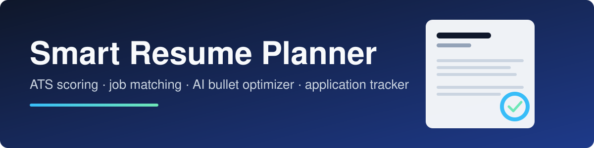
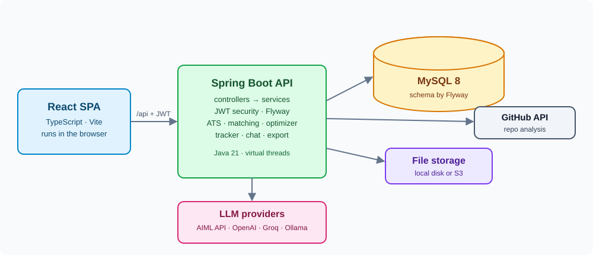

<p align="center">
  
</p>

<h1 align="center">Smart Resume Planner</h1>

<p align="center">
  An AI-assisted resume builder and job-application planner.<br>
  Score your resume against ATS rules, match it to job descriptions, optimize weak bullets, track applications, and export a polished PDF.
</p>

<p align="center">
  
  
  
  
  
  
</p>

---

## Features

| | |
|---|---|
| **ATS scoring** | Upload a PDF or DOCX and get a score with concrete issues to fix. An optional AI summary explains the result. |
| **Version control for resumes** | Every edit creates a new immutable version. Compare any two versions, or restore an older one. |
| **Job matching** | Paste a job description and see which required skills you have, which are missing, and the evidence for each. |
| **AI bullet optimizer** | Finds weak bullet points and proposes stronger rewrites that you can accept or reject one by one. |
| **Cover letters and interview prep** | Generates a cover letter and likely interview questions for a specific role. |
| **GitHub project import** | Analyzes public repositories and turns them into resume entries. |
| **Application tracker** | Kanban board with status history, follow-up reminders, and statistics. |
| **AI career coach** | Streaming chat (server-sent events) that knows your resume and target roles. |
| **PDF export** | Renders your resume with several templates (Classic, Modern, Technical). |

## Architecture

<p align="center">
  
</p>

The React single-page app talks to a Spring Boot REST API over `/api`. The API keeps data in MySQL (schema managed by Flyway), stores uploaded files on disk or S3, and calls an LLM provider through Spring AI. The default provider is AIML API; OpenAI, Groq, and Ollama (local) are available through Spring profiles.

## Tech stack

**Backend** (`smart-resume-planner/`): Java 21 with virtual threads, Spring Boot 3.5, Spring Security with JWT (rotating refresh tokens), Spring Data JPA, Flyway, Spring AI, Apache Tika, OpenPDF, springdoc OpenAPI.

**Frontend** (`smart-resume-frontend/`): React 18, TypeScript, Vite, React Router, light and dark themes.

## Getting started

Each part has its own setup guide:

- **Backend**: [smart-resume-planner/README.md](smart-resume-planner/README.md). Needs MySQL 8 (or `docker compose up -d` from that folder) and the environment variables in [`.env.example`](smart-resume-planner/.env.example).
- **Frontend**: [smart-resume-frontend/README.md](smart-resume-frontend/README.md). Needs Node.js 20+. Run `npm install` and `npm run dev`.

Start the backend first. The frontend dev server proxies `/api` to `http://localhost:8080`.

## Repository layout

```
.
├── docs/                    Images used in this README
├── smart-resume-planner/    Spring Boot backend (REST API, AI services, PDF export)
└── smart-resume-frontend/   React + TypeScript web app
```

## Configuration

Secrets are never stored in the repository. The backend reads them from environment variables:

| Variable | Required | Purpose |
|---|---|---|
| `JWT_SECRET` | yes | Signing key for access tokens (base64, 256+ bits) |
| `DB_PASSWORD` | yes | MySQL password |
| `AIML_API_KEY` | for the default AI profile | LLM provider key |
| `DB_USER`, `DB_HOST`, `DB_PORT`, `DB_NAME` | no | Database connection (defaults in `.env.example`) |
| `GITHUB_TOKEN` | no | Raises the GitHub API rate limit |

## Contributing

Contributions are welcome. See [CONTRIBUTING.md](CONTRIBUTING.md) for the workflow and coding conventions.
